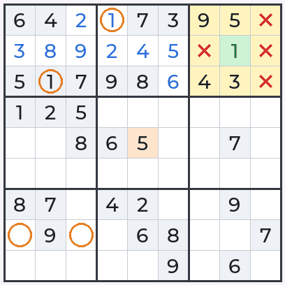

<!-- Written by tools/walkthrough.py point-symmetry: edit the script, not this page. -->
# Point Symmetry, step 10: the 1 in box 3

**Step 10 of 50** · [← Step 9](step-09.md) · [All steps](../point-symmetry.md#the-whole-puzzle-step-by-step) · [Step 11 →](step-11.md)

Box 3 needs a 1. r1c9: row 1 has one (r1c4). r3c9: row 3 has one (r3c2). r2c7: its mirror through the centre, r8c3, can't be 9, which a 1 would need. r2c9: its mirror through the centre, r8c1, can't be 9, which a 1 would need. Only **r2c8** is left: **r2c8 = 1**.

**Step 10 of 50** · [← Step 9](step-09.md) · [All steps](../point-symmetry.md#the-whole-puzzle-step-by-step) · [Step 11 →](step-11.md)
