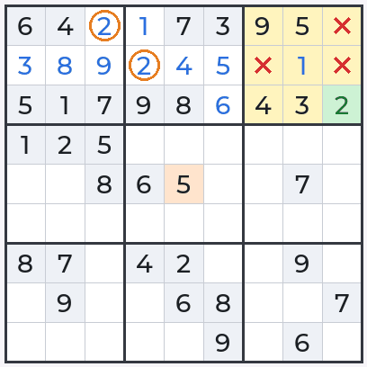

<!-- Written by tools/walkthrough.py point-symmetry: edit the script, not this page. -->
# Point Symmetry, step 11: the 2 in box 3

**Step 11 of 50** · [← Step 10](step-10.md) · [All steps](../point-symmetry.md#the-whole-puzzle-step-by-step) · [Step 12 →](step-12.md)

Box 3 needs a 2. r1c9: row 1 has one (r1c3). r2c7 and r2c9: row 2 has one (r2c4). Only **r3c9** is left: **r3c9 = 2**.

**Step 11 of 50** · [← Step 10](step-10.md) · [All steps](../point-symmetry.md#the-whole-puzzle-step-by-step) · [Step 12 →](step-12.md)
