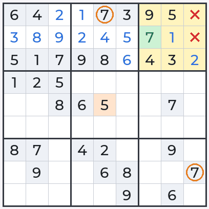

<!-- Written by tools/walkthrough.py point-symmetry: edit the script, not this page. -->
# Point Symmetry, step 12: the 7 in box 3

**Step 12 of 50** · [← Step 11](step-11.md) · [All steps](../point-symmetry.md#the-whole-puzzle-step-by-step) · [Step 13 →](step-13.md)

Box 3 needs a 7. r1c9: row 1 has one (r1c5). r2c9: column 9 has one (r8c9). Only **r2c7** is left: **r2c7 = 7**.

**Step 12 of 50** · [← Step 11](step-11.md) · [All steps](../point-symmetry.md#the-whole-puzzle-step-by-step) · [Step 13 →](step-13.md)
