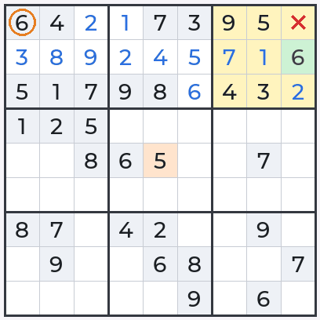

<!-- Written by tools/walkthrough.py point-symmetry: edit the script, not this page. -->
# Point Symmetry, step 13: the 6 in box 3

**Step 13 of 50** · [← Step 12](step-12.md) · [All steps](../point-symmetry.md#the-whole-puzzle-step-by-step) · [Step 14 →](step-14.md)

Box 3 needs a 6. r1c9: row 1 has one (r1c1). Only **r2c9** is left: **r2c9 = 6**.

**Step 13 of 50** · [← Step 12](step-12.md) · [All steps](../point-symmetry.md#the-whole-puzzle-step-by-step) · [Step 14 →](step-14.md)
