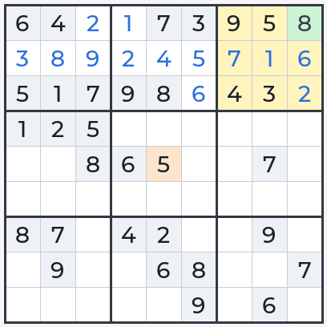

<!-- Written by tools/walkthrough.py point-symmetry: edit the script, not this page. -->
# Point Symmetry, step 14: the 8 in box 3

**Step 14 of 50** · [← Step 13](step-13.md) · [All steps](../point-symmetry.md#the-whole-puzzle-step-by-step) · [Step 15 →](step-15.md)

Box 3 needs an 8, and r1c9 is its last empty cell: **r1c9 = 8**.

**Step 14 of 50** · [← Step 13](step-13.md) · [All steps](../point-symmetry.md#the-whole-puzzle-step-by-step) · [Step 15 →](step-15.md)
