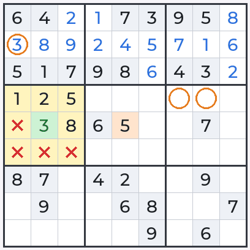

<!-- Written by tools/walkthrough.py point-symmetry: edit the script, not this page. -->
# Point Symmetry, step 15: the 3 in box 4

**Step 15 of 50** · [← Step 14](step-14.md) · [All steps](../point-symmetry.md#the-whole-puzzle-step-by-step) · [Step 16 →](step-16.md)

Box 4 needs a 3. r5c1 and r6c1: column 1 has one (r2c1). r6c2: its mirror through the centre, r4c8, can't be 7, which a 3 would need. r6c3: its mirror through the centre, r4c7, can't be 7, which a 3 would need. Only **r5c2** is left: **r5c2 = 3**.

**Step 15 of 50** · [← Step 14](step-14.md) · [All steps](../point-symmetry.md#the-whole-puzzle-step-by-step) · [Step 16 →](step-16.md)
