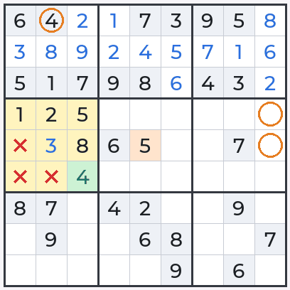

<!-- Written by tools/walkthrough.py point-symmetry: edit the script, not this page. -->
# Point Symmetry, step 16: the 4 in box 4

**Step 16 of 50** · [← Step 15](step-15.md) · [All steps](../point-symmetry.md#the-whole-puzzle-step-by-step) · [Step 17 →](step-17.md)

Box 4 needs a 4. r6c2: column 2 has one (r1c2). r5c1: its mirror through the centre, r5c9, can't be 6, which a 4 would need. r6c1: its mirror through the centre, r4c9, can't be 6, which a 4 would need. Only **r6c3** is left: **r6c3 = 4**.

**Step 16 of 50** · [← Step 15](step-15.md) · [All steps](../point-symmetry.md#the-whole-puzzle-step-by-step) · [Step 17 →](step-17.md)
