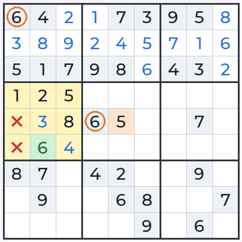

<!-- Written by tools/walkthrough.py point-symmetry: edit the script, not this page. -->
# Point Symmetry, step 17: the 6 in box 4

**Step 17 of 50** · [← Step 16](step-16.md) · [All steps](../point-symmetry.md#the-whole-puzzle-step-by-step) · [Step 18 →](step-18.md)

Box 4 needs a 6. r5c1: row 5 has one (r5c4). r6c1: column 1 has one (r1c1). Only **r6c2** is left: **r6c2 = 6**.

**Step 17 of 50** · [← Step 16](step-16.md) · [All steps](../point-symmetry.md#the-whole-puzzle-step-by-step) · [Step 18 →](step-18.md)
