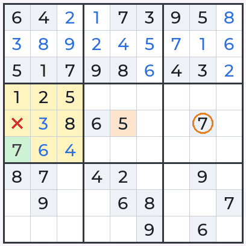

<!-- Written by tools/walkthrough.py point-symmetry: edit the script, not this page. -->
# Point Symmetry, step 18: the 7 in box 4

**Step 18 of 50** · [← Step 17](step-17.md) · [All steps](../point-symmetry.md#the-whole-puzzle-step-by-step) · [Step 19 →](step-19.md)

Box 4 needs a 7. r5c1: row 5 has one (r5c8). Only **r6c1** is left: **r6c1 = 7**.

**Step 18 of 50** · [← Step 17](step-17.md) · [All steps](../point-symmetry.md#the-whole-puzzle-step-by-step) · [Step 19 →](step-19.md)
