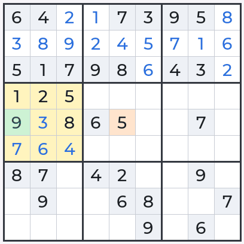

<!-- Written by tools/walkthrough.py point-symmetry: edit the script, not this page. -->
# Point Symmetry, step 19: the 9 in box 4

**Step 19 of 50** · [← Step 18](step-18.md) · [All steps](../point-symmetry.md#the-whole-puzzle-step-by-step) · [Step 20 →](step-20.md)

Box 4 needs a 9, and r5c1 is its last empty cell: **r5c1 = 9**.

**Step 19 of 50** · [← Step 18](step-18.md) · [All steps](../point-symmetry.md#the-whole-puzzle-step-by-step) · [Step 20 →](step-20.md)
