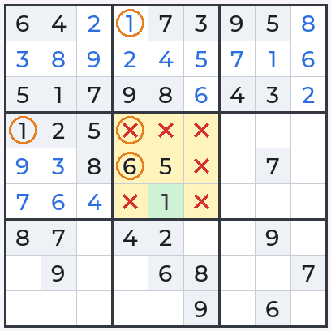

<!-- Written by tools/walkthrough.py point-symmetry: edit the script, not this page. -->
# Point Symmetry, step 20: the 1 in box 5

**Step 20 of 50** · [← Step 19](step-19.md) · [All steps](../point-symmetry.md#the-whole-puzzle-step-by-step) · [Step 21 →](step-21.md)

Box 5 needs a 1. r4c4, r4c5 and r4c6: row 4 has one (r4c1). r6c4: column 4 has one (r1c4). r5c6: its mirror through the centre, r5c4, is 6: a 1 there wouldn't make 10. r6c6: its mirror through the centre, r4c4, can't be 9, which a 1 would need. Only **r6c5** is left: **r6c5 = 1**.

**Step 20 of 50** · [← Step 19](step-19.md) · [All steps](../point-symmetry.md#the-whole-puzzle-step-by-step) · [Step 21 →](step-21.md)
