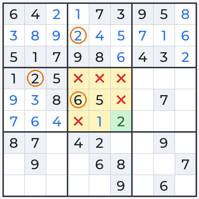

<!-- Written by tools/walkthrough.py point-symmetry: edit the script, not this page. -->
# Point Symmetry, step 21: the 2 in box 5

**Step 21 of 50** · [← Step 20](step-20.md) · [All steps](../point-symmetry.md#the-whole-puzzle-step-by-step) · [Step 22 →](step-22.md)

Box 5 needs a 2. r4c4, r4c5 and r4c6: row 4 has one (r4c2). r6c4: column 4 has one (r2c4). r5c6: its mirror through the centre, r5c4, is 6: a 2 there wouldn't make 10. Only **r6c6** is left: **r6c6 = 2**.

**Step 21 of 50** · [← Step 20](step-20.md) · [All steps](../point-symmetry.md#the-whole-puzzle-step-by-step) · [Step 22 →](step-22.md)
