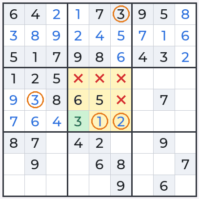

<!-- Written by tools/walkthrough.py point-symmetry: edit the script, not this page. -->
# Point Symmetry, step 22: the 3 in box 5

**Step 22 of 50** · [← Step 21](step-21.md) · [All steps](../point-symmetry.md#the-whole-puzzle-step-by-step) · [Step 23 →](step-23.md)

Box 5 needs a 3. r4c6: column 6 has one (r1c6). r5c6: row 5 has one (r5c2). r4c4: its mirror through the centre, r6c6, is 2: a 3 there wouldn't make 10. r4c5: its mirror through the centre, r6c5, is 1: a 3 there wouldn't make 10. Only **r6c4** is left: **r6c4 = 3**.

**Step 22 of 50** · [← Step 21](step-21.md) · [All steps](../point-symmetry.md#the-whole-puzzle-step-by-step) · [Step 23 →](step-23.md)
