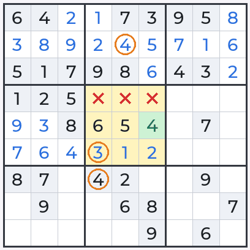

<!-- Written by tools/walkthrough.py point-symmetry: edit the script, not this page. -->
# Point Symmetry, step 23: the 4 in box 5

**Step 23 of 50** · [← Step 22](step-22.md) · [All steps](../point-symmetry.md#the-whole-puzzle-step-by-step) · [Step 24 →](step-24.md)

Box 5 needs a 4. r4c4: column 4 has one (r7c4). r4c5: column 5 has one (r2c5). r4c6: its mirror through the centre, r6c4, is 3: a 4 there wouldn't make 10. Only **r5c6** is left: **r5c6 = 4**.

**Step 23 of 50** · [← Step 22](step-22.md) · [All steps](../point-symmetry.md#the-whole-puzzle-step-by-step) · [Step 24 →](step-24.md)
