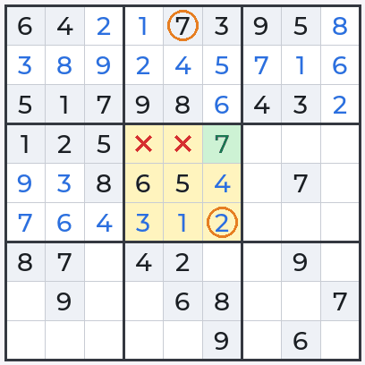

<!-- Written by tools/walkthrough.py point-symmetry: edit the script, not this page. -->
# Point Symmetry, step 24: the 7 in box 5

**Step 24 of 50** · [← Step 23](step-23.md) · [All steps](../point-symmetry.md#the-whole-puzzle-step-by-step) · [Step 25 →](step-25.md)

Box 5 needs a 7. r4c5: column 5 has one (r1c5). r4c4: its mirror through the centre, r6c6, is 2: a 7 there wouldn't make 10. Only **r4c6** is left: **r4c6 = 7**.

**Step 24 of 50** · [← Step 23](step-23.md) · [All steps](../point-symmetry.md#the-whole-puzzle-step-by-step) · [Step 25 →](step-25.md)
