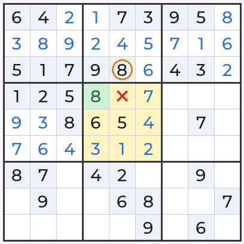

<!-- Written by tools/walkthrough.py point-symmetry: edit the script, not this page. -->
# Point Symmetry, step 25: the 8 in box 5

**Step 25 of 50** · [← Step 24](step-24.md) · [All steps](../point-symmetry.md#the-whole-puzzle-step-by-step) · [Step 26 →](step-26.md)

Box 5 needs an 8. r4c5: column 5 has one (r3c5). Only **r4c4** is left: **r4c4 = 8**.

**Step 25 of 50** · [← Step 24](step-24.md) · [All steps](../point-symmetry.md#the-whole-puzzle-step-by-step) · [Step 26 →](step-26.md)
