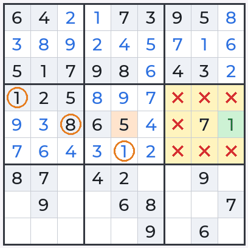

<!-- Written by tools/walkthrough.py point-symmetry: edit the script, not this page. -->
# Point Symmetry, step 27: the 1 in box 6

**Step 27 of 50** · [← Step 26](step-26.md) · [All steps](../point-symmetry.md#the-whole-puzzle-step-by-step) · [Step 28 →](step-28.md)

Box 6 needs a 1. r4c7, r4c8 and r4c9: row 4 has one (r4c1). r6c7, r6c8 and r6c9: row 6 has one (r6c5). r5c7: its mirror through the centre, r5c3, is 8: a 1 there wouldn't make 10. Only **r5c9** is left: **r5c9 = 1**.

**Step 27 of 50** · [← Step 26](step-26.md) · [All steps](../point-symmetry.md#the-whole-puzzle-step-by-step) · [Step 28 →](step-28.md)
