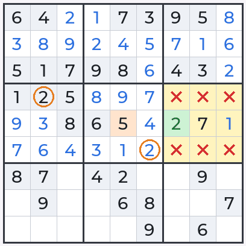

<!-- Written by tools/walkthrough.py point-symmetry: edit the script, not this page. -->
# Point Symmetry, step 28: the 2 in box 6

**Step 28 of 50** · [← Step 27](step-27.md) · [All steps](../point-symmetry.md#the-whole-puzzle-step-by-step) · [Step 29 →](step-29.md)

Box 6 needs a 2. r4c7, r4c8 and r4c9: row 4 has one (r4c2). r6c7, r6c8 and r6c9: row 6 has one (r6c6). Only **r5c7** is left: **r5c7 = 2**.

**Step 28 of 50** · [← Step 27](step-27.md) · [All steps](../point-symmetry.md#the-whole-puzzle-step-by-step) · [Step 29 →](step-29.md)
