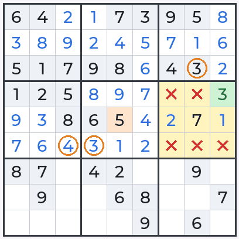

<!-- Written by tools/walkthrough.py point-symmetry: edit the script, not this page. -->
# Point Symmetry, step 29: the 3 in box 6

**Step 29 of 50** · [← Step 28](step-28.md) · [All steps](../point-symmetry.md#the-whole-puzzle-step-by-step) · [Step 30 →](step-30.md)

Box 6 needs a 3. r4c8: column 8 has one (r3c8). r6c7, r6c8 and r6c9: row 6 has one (r6c4). r4c7: its mirror through the centre, r6c3, is 4: a 3 there wouldn't make 10. Only **r4c9** is left: **r4c9 = 3**.

**Step 29 of 50** · [← Step 28](step-28.md) · [All steps](../point-symmetry.md#the-whole-puzzle-step-by-step) · [Step 30 →](step-30.md)
