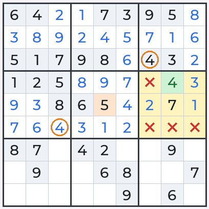

<!-- Written by tools/walkthrough.py point-symmetry: edit the script, not this page. -->
# Point Symmetry, step 30: the 4 in box 6

**Step 30 of 50** · [← Step 29](step-29.md) · [All steps](../point-symmetry.md#the-whole-puzzle-step-by-step) · [Step 31 →](step-31.md)

Box 6 needs a 4. r4c7: column 7 has one (r3c7). r6c7, r6c8 and r6c9: row 6 has one (r6c3). Only **r4c8** is left: **r4c8 = 4**.

**Step 30 of 50** · [← Step 29](step-29.md) · [All steps](../point-symmetry.md#the-whole-puzzle-step-by-step) · [Step 31 →](step-31.md)
