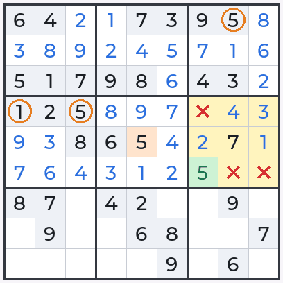

<!-- Written by tools/walkthrough.py point-symmetry: edit the script, not this page. -->
# Point Symmetry, step 31: the 5 in box 6

**Step 31 of 50** · [← Step 30](step-30.md) · [All steps](../point-symmetry.md#the-whole-puzzle-step-by-step) · [Step 32 →](step-32.md)

Box 6 needs a 5. r4c7: row 4 has one (r4c3). r6c8: column 8 has one (r1c8). r6c9: its mirror through the centre, r4c1, is 1: a 5 there wouldn't make 10. Only **r6c7** is left: **r6c7 = 5**.

**Step 31 of 50** · [← Step 30](step-30.md) · [All steps](../point-symmetry.md#the-whole-puzzle-step-by-step) · [Step 32 →](step-32.md)
