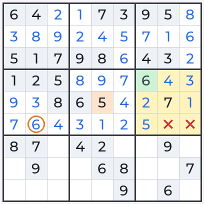

<!-- Written by tools/walkthrough.py point-symmetry: edit the script, not this page. -->
# Point Symmetry, step 32: the 6 in box 6

**Step 32 of 50** · [← Step 31](step-31.md) · [All steps](../point-symmetry.md#the-whole-puzzle-step-by-step) · [Step 33 →](step-33.md)

Box 6 needs a 6. r6c8 and r6c9: row 6 has one (r6c2). Only **r4c7** is left: **r4c7 = 6**.

**Step 32 of 50** · [← Step 31](step-31.md) · [All steps](../point-symmetry.md#the-whole-puzzle-step-by-step) · [Step 33 →](step-33.md)
