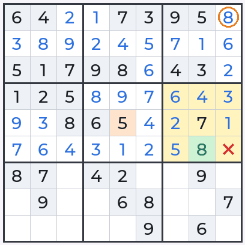

<!-- Written by tools/walkthrough.py point-symmetry: edit the script, not this page. -->
# Point Symmetry, step 33: the 8 in box 6

**Step 33 of 50** · [← Step 32](step-32.md) · [All steps](../point-symmetry.md#the-whole-puzzle-step-by-step) · [Step 34 →](step-34.md)

Box 6 needs an 8. r6c9: column 9 has one (r1c9). Only **r6c8** is left: **r6c8 = 8**.

**Step 33 of 50** · [← Step 32](step-32.md) · [All steps](../point-symmetry.md#the-whole-puzzle-step-by-step) · [Step 34 →](step-34.md)
