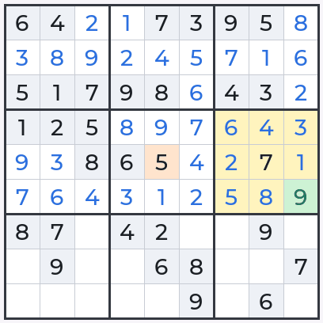

<!-- Written by tools/walkthrough.py point-symmetry: edit the script, not this page. -->
# Point Symmetry, step 34: the 9 in box 6

**Step 34 of 50** · [← Step 33](step-33.md) · [All steps](../point-symmetry.md#the-whole-puzzle-step-by-step) · [Step 35 →](step-35.md)

Box 6 needs a 9, and r6c9 is its last empty cell: **r6c9 = 9**.

**Step 34 of 50** · [← Step 33](step-33.md) · [All steps](../point-symmetry.md#the-whole-puzzle-step-by-step) · [Step 35 →](step-35.md)
