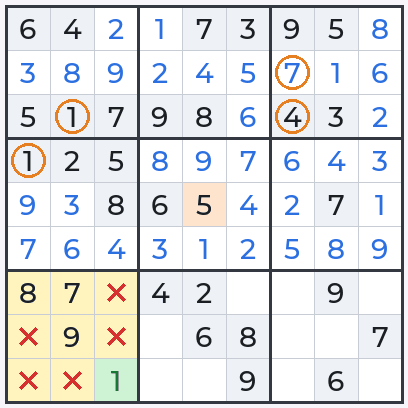

<!-- Written by tools/walkthrough.py point-symmetry: edit the script, not this page. -->
# Point Symmetry, step 35: the 1 in box 7

**Step 35 of 50** · [← Step 34](step-34.md) · [All steps](../point-symmetry.md#the-whole-puzzle-step-by-step) · [Step 36 →](step-36.md)

Box 7 needs a 1. r8c1 and r9c1: column 1 has one (r4c1). r9c2: column 2 has one (r3c2). r7c3: its mirror through the centre, r3c7, is 4: a 1 there wouldn't make 10. r8c3: its mirror through the centre, r2c7, is 7: a 1 there wouldn't make 10. Only **r9c3** is left: **r9c3 = 1**.

**Step 35 of 50** · [← Step 34](step-34.md) · [All steps](../point-symmetry.md#the-whole-puzzle-step-by-step) · [Step 36 →](step-36.md)
