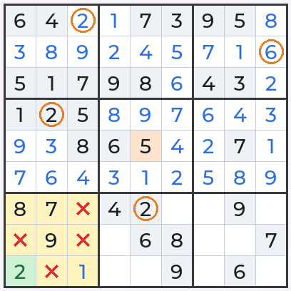

<!-- Written by tools/walkthrough.py point-symmetry: edit the script, not this page. -->
# Point Symmetry, step 36: the 2 in box 7

**Step 36 of 50** · [← Step 35](step-35.md) · [All steps](../point-symmetry.md#the-whole-puzzle-step-by-step) · [Step 37 →](step-37.md)

Box 7 needs a 2. r7c3: row 7 has one (r7c5). r8c3: column 3 has one (r1c3). r9c2: column 2 has one (r4c2). r8c1: its mirror through the centre, r2c9, is 6: a 2 there wouldn't make 10. Only **r9c1** is left: **r9c1 = 2**.

**Step 36 of 50** · [← Step 35](step-35.md) · [All steps](../point-symmetry.md#the-whole-puzzle-step-by-step) · [Step 37 →](step-37.md)
