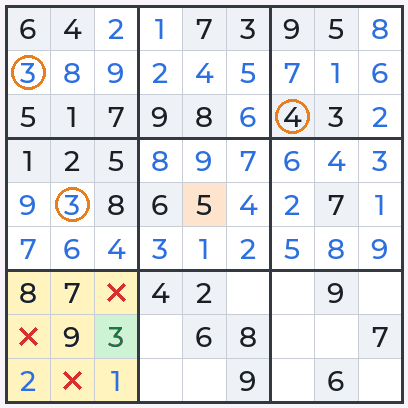

<!-- Written by tools/walkthrough.py point-symmetry: edit the script, not this page. -->
# Point Symmetry, step 37: the 3 in box 7

**Step 37 of 50** · [← Step 36](step-36.md) · [All steps](../point-symmetry.md#the-whole-puzzle-step-by-step) · [Step 38 →](step-38.md)

Box 7 needs a 3. r8c1: column 1 has one (r2c1). r9c2: column 2 has one (r5c2). r7c3: its mirror through the centre, r3c7, is 4: a 3 there wouldn't make 10. Only **r8c3** is left: **r8c3 = 3**.

**Step 37 of 50** · [← Step 36](step-36.md) · [All steps](../point-symmetry.md#the-whole-puzzle-step-by-step) · [Step 38 →](step-38.md)
