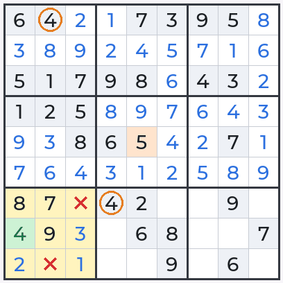

<!-- Written by tools/walkthrough.py point-symmetry: edit the script, not this page. -->
# Point Symmetry, step 38: the 4 in box 7

**Step 38 of 50** · [← Step 37](step-37.md) · [All steps](../point-symmetry.md#the-whole-puzzle-step-by-step) · [Step 39 →](step-39.md)

Box 7 needs a 4. r7c3: row 7 has one (r7c4). r9c2: column 2 has one (r1c2). Only **r8c1** is left: **r8c1 = 4**.

**Step 38 of 50** · [← Step 37](step-37.md) · [All steps](../point-symmetry.md#the-whole-puzzle-step-by-step) · [Step 39 →](step-39.md)
