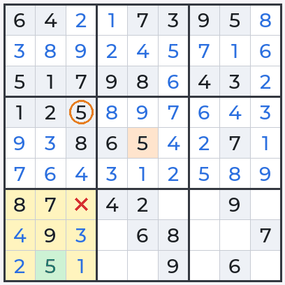

<!-- Written by tools/walkthrough.py point-symmetry: edit the script, not this page. -->
# Point Symmetry, step 39: the 5 in box 7

**Step 39 of 50** · [← Step 38](step-38.md) · [All steps](../point-symmetry.md#the-whole-puzzle-step-by-step) · [Step 40 →](step-40.md)

Box 7 needs a 5. r7c3: column 3 has one (r4c3). Only **r9c2** is left: **r9c2 = 5**.

**Step 39 of 50** · [← Step 38](step-38.md) · [All steps](../point-symmetry.md#the-whole-puzzle-step-by-step) · [Step 40 →](step-40.md)
