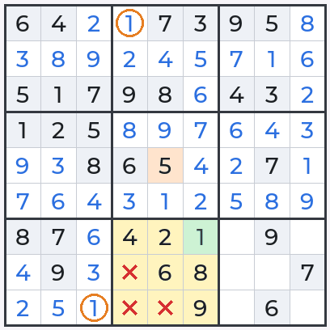

<!-- Written by tools/walkthrough.py point-symmetry: edit the script, not this page. -->
# Point Symmetry, step 41: the 1 in box 8

**Step 41 of 50** · [← Step 40](step-40.md) · [All steps](../point-symmetry.md#the-whole-puzzle-step-by-step) · [Step 42 →](step-42.md)

Box 8 needs a 1. r8c4: column 4 has one (r1c4). r9c4 and r9c5: row 9 has one (r9c3). Only **r7c6** is left: **r7c6 = 1**.

**Step 41 of 50** · [← Step 40](step-40.md) · [All steps](../point-symmetry.md#the-whole-puzzle-step-by-step) · [Step 42 →](step-42.md)
