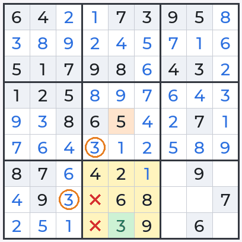

<!-- Written by tools/walkthrough.py point-symmetry: edit the script, not this page. -->
# Point Symmetry, step 42: the 3 in box 8

**Step 42 of 50** · [← Step 41](step-41.md) · [All steps](../point-symmetry.md#the-whole-puzzle-step-by-step) · [Step 43 →](step-43.md)

Box 8 needs a 3. r8c4: row 8 has one (r8c3). r9c4: column 4 has one (r6c4). Only **r9c5** is left: **r9c5 = 3**.

**Step 42 of 50** · [← Step 41](step-41.md) · [All steps](../point-symmetry.md#the-whole-puzzle-step-by-step) · [Step 43 →](step-43.md)
