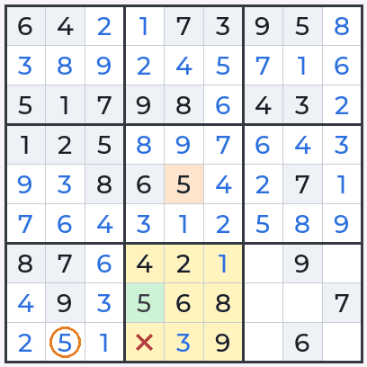

<!-- Written by tools/walkthrough.py point-symmetry: edit the script, not this page. -->
# Point Symmetry, step 43: the 5 in box 8

**Step 43 of 50** · [← Step 42](step-42.md) · [All steps](../point-symmetry.md#the-whole-puzzle-step-by-step) · [Step 44 →](step-44.md)

Box 8 needs a 5. r9c4: row 9 has one (r9c2). Only **r8c4** is left: **r8c4 = 5**.

**Step 43 of 50** · [← Step 42](step-42.md) · [All steps](../point-symmetry.md#the-whole-puzzle-step-by-step) · [Step 44 →](step-44.md)
