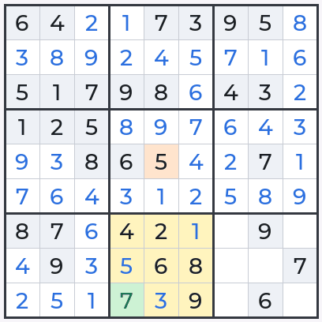

<!-- Written by tools/walkthrough.py point-symmetry: edit the script, not this page. -->
# Point Symmetry, step 44: the 7 in box 8

**Step 44 of 50** · [← Step 43](step-43.md) · [All steps](../point-symmetry.md#the-whole-puzzle-step-by-step) · [Step 45 →](step-45.md)

Box 8 needs a 7, and r9c4 is its last empty cell: **r9c4 = 7**.

**Step 44 of 50** · [← Step 43](step-43.md) · [All steps](../point-symmetry.md#the-whole-puzzle-step-by-step) · [Step 45 →](step-45.md)
