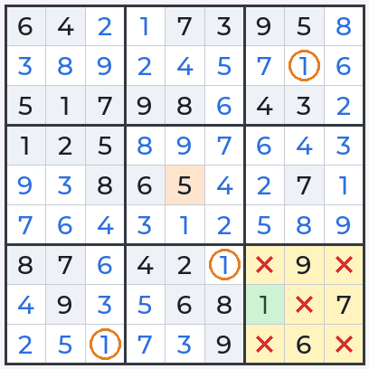

<!-- Written by tools/walkthrough.py point-symmetry: edit the script, not this page. -->
# Point Symmetry, step 45: the 1 in box 9

**Step 45 of 50** · [← Step 44](step-44.md) · [All steps](../point-symmetry.md#the-whole-puzzle-step-by-step) · [Step 46 →](step-46.md)

Box 9 needs a 1. r7c7 and r7c9: row 7 has one (r7c6). r8c8: column 8 has one (r2c8). r9c7 and r9c9: row 9 has one (r9c3). Only **r8c7** is left: **r8c7 = 1**.

**Step 45 of 50** · [← Step 44](step-44.md) · [All steps](../point-symmetry.md#the-whole-puzzle-step-by-step) · [Step 46 →](step-46.md)
