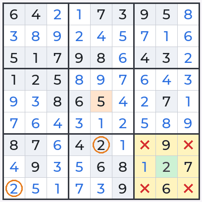

<!-- Written by tools/walkthrough.py point-symmetry: edit the script, not this page. -->
# Point Symmetry, step 46: the 2 in box 9

**Step 46 of 50** · [← Step 45](step-45.md) · [All steps](../point-symmetry.md#the-whole-puzzle-step-by-step) · [Step 47 →](step-47.md)

Box 9 needs a 2. r7c7 and r7c9: row 7 has one (r7c5). r9c7 and r9c9: row 9 has one (r9c1). Only **r8c8** is left: **r8c8 = 2**.

**Step 46 of 50** · [← Step 45](step-45.md) · [All steps](../point-symmetry.md#the-whole-puzzle-step-by-step) · [Step 47 →](step-47.md)
