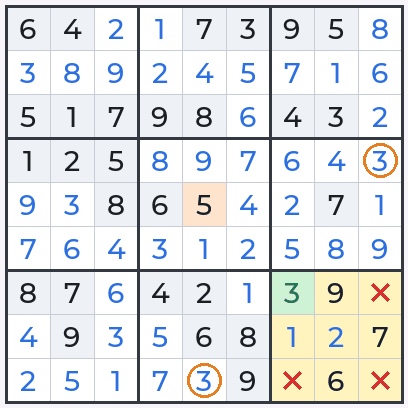

<!-- Written by tools/walkthrough.py point-symmetry: edit the script, not this page. -->
# Point Symmetry, step 47: the 3 in box 9

**Step 47 of 50** · [← Step 46](step-46.md) · [All steps](../point-symmetry.md#the-whole-puzzle-step-by-step) · [Step 48 →](step-48.md)

Box 9 needs a 3. r7c9: column 9 has one (r4c9). r9c7 and r9c9: row 9 has one (r9c5). Only **r7c7** is left: **r7c7 = 3**.

**Step 47 of 50** · [← Step 46](step-46.md) · [All steps](../point-symmetry.md#the-whole-puzzle-step-by-step) · [Step 48 →](step-48.md)
