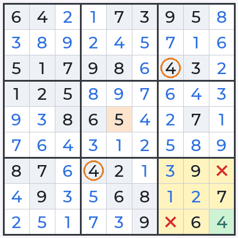

<!-- Written by tools/walkthrough.py point-symmetry: edit the script, not this page. -->
# Point Symmetry, step 48: the 4 in box 9

**Step 48 of 50** · [← Step 47](step-47.md) · [All steps](../point-symmetry.md#the-whole-puzzle-step-by-step) · [Step 49 →](step-49.md)

Box 9 needs a 4. r7c9: row 7 has one (r7c4). r9c7: column 7 has one (r3c7). Only **r9c9** is left: **r9c9 = 4**.

**Step 48 of 50** · [← Step 47](step-47.md) · [All steps](../point-symmetry.md#the-whole-puzzle-step-by-step) · [Step 49 →](step-49.md)
