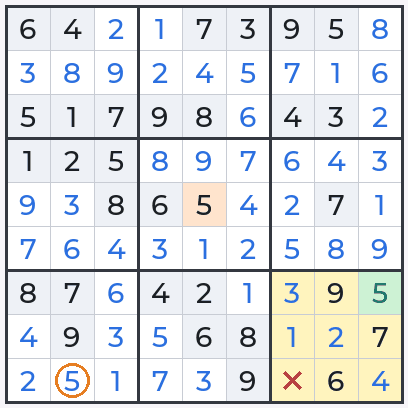

<!-- Written by tools/walkthrough.py point-symmetry: edit the script, not this page. -->
# Point Symmetry, step 49: the 5 in box 9

**Step 49 of 50** · [← Step 48](step-48.md) · [All steps](../point-symmetry.md#the-whole-puzzle-step-by-step) · [Step 50 →](step-50.md)

Box 9 needs a 5. r9c7: row 9 has one (r9c2). Only **r7c9** is left: **r7c9 = 5**.

**Step 49 of 50** · [← Step 48](step-48.md) · [All steps](../point-symmetry.md#the-whole-puzzle-step-by-step) · [Step 50 →](step-50.md)
