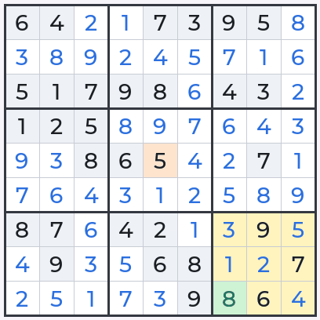

<!-- Written by tools/walkthrough.py point-symmetry: edit the script, not this page. -->
# Point Symmetry, step 50: the 8 in box 9

**Step 50 of 50** · [← Step 49](step-49.md) · [All steps](../point-symmetry.md#the-whole-puzzle-step-by-step) · [All steps](../point-symmetry.md#the-whole-puzzle-step-by-step)

Box 9 needs an 8, and r9c7 is its last empty cell: **r9c7 = 8**.

Solved.

**Step 50 of 50** · [← Step 49](step-49.md) · [All steps](../point-symmetry.md#the-whole-puzzle-step-by-step) · [All steps](../point-symmetry.md#the-whole-puzzle-step-by-step)
