# Product Killer

[← All variants](README.md) · [Puzzles](../features-puzzles.md) · [How to play](../how-to-play.md)

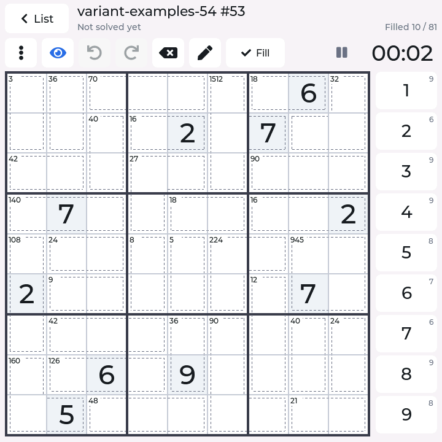

## The rules

[Classic](classic.md) rules, plus **cages** (dashed outlines): the digits in a cage **multiply** to the number in its corner, and no digit repeats in a cage. A cage of 12 over two cells is 3 and 4 (or 2 and 6); one of 70 over three cells is 2, 5 and 7.

## On the board

- Cages are drawn as in [Killer](killer.md), with their product in the top-left corner.
- A cage turns red when a digit in it doesn't divide its number, or when it's full and the digits multiply to something else.
- The grader and hints try every way to fill a cage: "The cage at row 5, column 6 multiplies to 224: with what's in it and around it, its empty cells can only be 4, 7, 8."
- **Puzzles → ⋮ → New puzzle → Clues → Product**: Easy, Medium and **Hard**. There's no Expert: products pin the digits down so well that Expert puzzles are rare (hundreds of tries each), so the button is greyed out, as Kids 4×4's are.

## How to solve it

- **Factor the number:** 224 = 2 × 2 × 2 × 2 × 2 × 7 over three cells can only be 4 × 7 × 8; a 7 (or 5) in a product puts a 7 (or 5) in the cage.
- **Primes are strong:** a two-cell cage of 5 is 1 and 5; of 7, 1 and 7.
- **What isn't a factor:** a cage whose number is odd has no even digit; one not divisible by 3 has no 3, 6 or 9.

## Worked example

**variant-examples #53**, Product Killer Easy (see [Classic](classic.md#worked-example-the-whole-puzzle) for how to import the examples; cells are written r*row*c*column*).

**Step 1: the 2 in row 5.** r5c1, r5c2 and r5c3 see the 2 in r6c1; r5c5 the 2 in r2c5; r5c7 to r5c9 the 2 in r4c9. r5c6 is in a cage of 224 with r5c7 and r6c6: three different digits multiplying to 224 can only be 4, 7 and 8, so no 2. Only **r5c4** is left: **r5c4 = 2**.

**Step 2: the 7 in row 5.** r5c1 to r5c3 see the 7 in r4c2, r5c7 the 7 in r2c7, r5c8 and r5c9 the 7 in r6c8. r5c5 is in a cage of 5 with r6c5: that's 1 and 5. So the 7 is in **r5c6** (one of the 224 cage's 4, 7, 8): **r5c6 = 7**.

**Step 3: the 2 in row 1.** r1c2 is in a cage of 36 with r2c2: two different digits making 36 are 4 and 9, so no 2. r1c7 is in a cage of 18 with the 6 in r1c8: it's 3. The others see a 2 in their column or box. **r1c3 = 2**.

## The whole puzzle, step by step

<!-- walkthrough -->
<!-- Written by tools/walkthrough.py product-killer: edit the script, not this part. -->

The whole puzzle, from the start to the last cell: 71 steps, each one a single (one place left for a digit, or one digit left for a cell), taken in the order a box's single comes first, so not quite the order of the worked example above. In each picture, the unit the step looks at is tinted yellow (for a cell with one digit left: its row, column and box), the new digit is on green, the digits that rule cells out have an **orange ring**, and the empty cells they rule out a **red cross**. Givens are on grey, digits from earlier steps in blue.

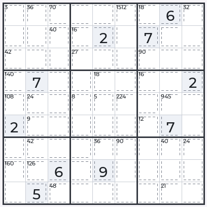

#### Step 1: the 2 in box 1

Box 1 needs a 2. r1c1 and r3c1: column 1 has one (r6c1). r2c1, r2c2 and r2c3: row 2 has one (r2c5). r1c2: in the cage of 36, a 2 would leave 18 for its other cell, which different digits can't make. r3c2: in the cage of 42, a 2 would leave 21 for its other cell, which different digits can't make. r3c3: in the cage of 40, a 2 would leave 20 for its other cell, which different digits can't make. Only **r1c3** is left: **r1c3 = 2**.

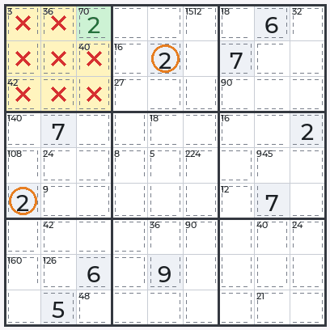

#### Step 2: the 7 in box 1

Box 1 needs a 7. r1c2 and r3c2: column 2 has one (r4c2). r2c1, r2c2 and r2c3: row 2 has one (r2c7). r1c1: the cage's digits multiply to 3, and 7 doesn't go into it. r3c3: the cage's digits multiply to 40, and 7 doesn't go into it. Only **r3c1** is left: **r3c1 = 7**.

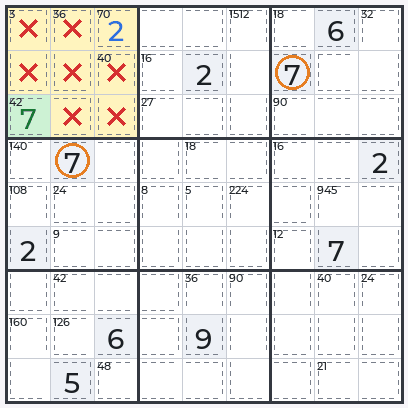

#### Step 3: the 6 in box 1

Box 1 needs a 6. r1c1 and r1c2: row 1 has one (r1c8). r2c3 and r3c3: column 3 has one (r8c3). r2c1: the cage's digits multiply to 3, and 6 doesn't go into it. r2c2: in the cage of 36, a 6 would leave 6 for its other cell, which different digits can't make. Only **r3c2** is left: **r3c2 = 6**.

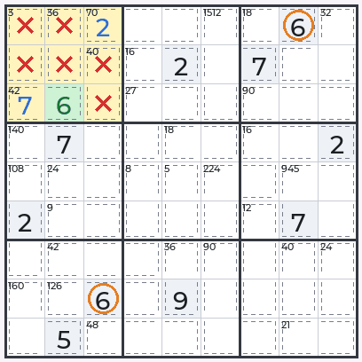

#### Step 4: the 6 in box 2

Box 2 needs a 6. r1c4, r1c5 and r1c6: row 1 has one (r1c8). r3c4, r3c5 and r3c6: row 3 has one (r3c2). r2c4: the cage of 16 (with 2 already in it) leaves 8 to make, and 6 doesn't go into it. Only **r2c6** is left: **r2c6 = 6**.

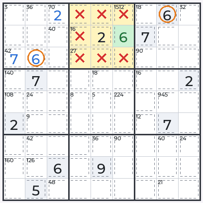

#### Step 5: the 8 in box 2

Box 2 needs an 8. r1c4 and r1c5: the cage of 70 (with 2 already in it) leaves 35 to make, and 8 doesn't go into it. r1c6 and r3c6: the cage of 1512 (with 6 and 7 already in it) leaves 36 to make, and 8 doesn't go into it. r3c4 and r3c5: the cage's digits multiply to 27, and 8 doesn't go into it. Only **r2c4** is left: **r2c4 = 8**.

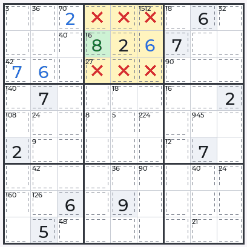

#### Step 6: the 8 in box 1

Box 1 needs an 8. r2c1, r2c2 and r2c3: row 2 has one (r2c4). r1c1: the cage's digits multiply to 3, and 8 doesn't go into it. r1c2: the cage's digits multiply to 36, and 8 doesn't go into it. Only **r3c3** is left: **r3c3 = 8**.

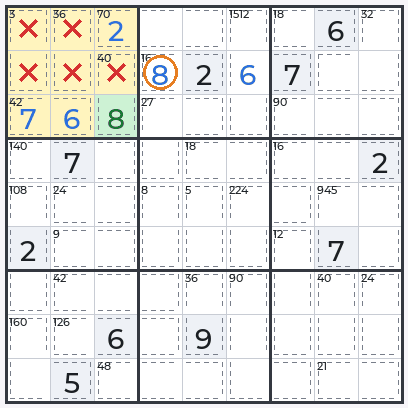

#### Step 7: the 5 in box 1

Box 1 needs a 5. r1c2 and r2c2: column 2 has one (r9c2). r1c1 and r2c1: the cage's digits multiply to 3, and 5 doesn't go into it. Only **r2c3** is left: **r2c3 = 5**.

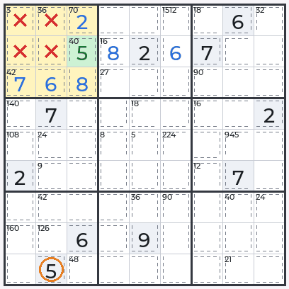

#### Step 8: the 8 in box 3

Box 3 needs an 8. r2c8 and r2c9: row 2 has one (r2c4). r3c7, r3c8 and r3c9: row 3 has one (r3c3). r1c7: the cage of 18 (with 6 already in it) leaves 3 to make, and 8 doesn't go into it. Only **r1c9** is left: **r1c9 = 8**.

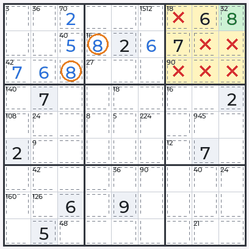

#### Step 9: the 5 in box 4

Box 4 needs a 5. r4c3, r5c3 and r6c3: column 3 has one (r2c3). r5c2 and r6c2: column 2 has one (r9c2). r5c1: the cage of 108 (with 2 already in it) leaves 54 to make, and 5 doesn't go into it. Only **r4c1** is left: **r4c1 = 5**.

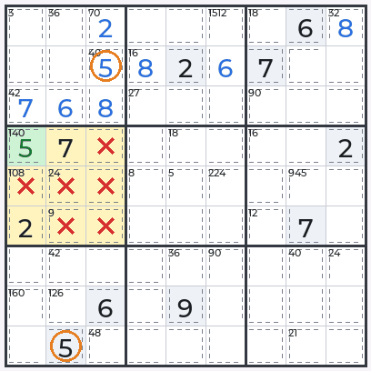

#### Step 10: the 6 in box 4

Box 4 needs a 6. r4c3, r5c3 and r6c3: column 3 has one (r8c3). r5c2 and r6c2: column 2 has one (r3c2). Only **r5c1** is left: **r5c1 = 6**.

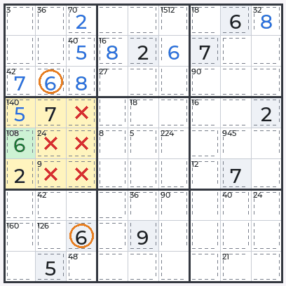

#### Step 11: the 8 in box 4

Box 4 needs an 8. r4c3, r5c3 and r6c3: column 3 has one (r3c3). r6c2: the cage's digits multiply to 9, and 8 doesn't go into it. Only **r5c2** is left: **r5c2 = 8**.

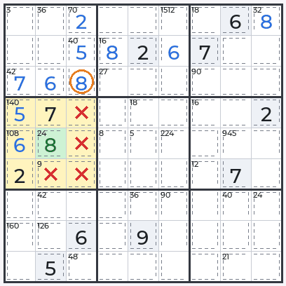

#### Step 12: the 3 in box 4

Box 4 needs a 3. r4c3: the cage of 140 (with 5 and 7 already in it) leaves 4 to make, and 3 doesn't go into it. r6c2 and r6c3: in the cage of 9, a 3 would leave 3 for its other cell, which different digits can't make. Only **r5c3** is left: **r5c3 = 3**.

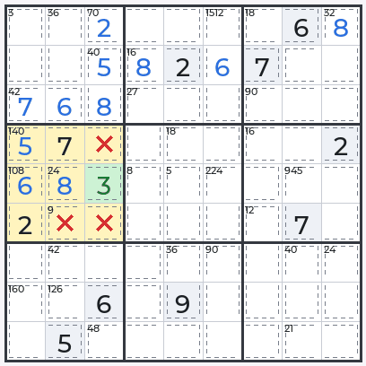

#### Step 13: the 4 in box 4

Box 4 needs a 4. r6c2 and r6c3: the cage's digits multiply to 9, and 4 doesn't go into it. Only **r4c3** is left: **r4c3 = 4**.

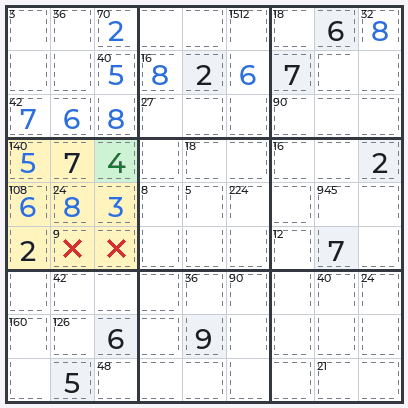

#### Step 14: the 2 in box 5

Box 5 needs a 2. r4c4, r4c5 and r4c6: row 4 has one (r4c9). r5c5: column 5 has one (r2c5). r6c4, r6c5 and r6c6: row 6 has one (r6c1). r5c6: in the cage of 224, a 2 would leave 112 for its other 2 cells, which different digits can't make. Only **r5c4** is left: **r5c4 = 2**.

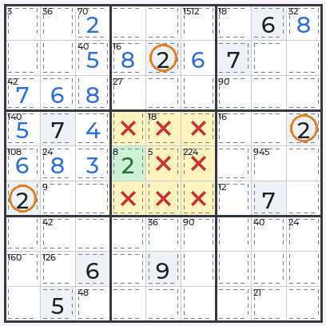

#### Step 15: the 6 in box 5

Box 5 needs a 6. r4c6 and r6c6: column 6 has one (r2c6). r5c5 and r5c6: row 5 has one (r5c1). r4c4: the cage's digits multiply to 27, and 6 doesn't go into it. r6c4: the cage of 8 (with 2 already in it) leaves 4 to make, and 6 doesn't go into it. r6c5: the cage's digits multiply to 5, and 6 doesn't go into it. Only **r4c5** is left: **r4c5 = 6**.

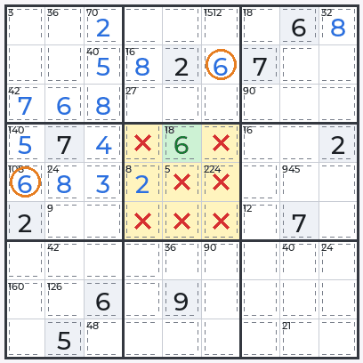

#### Step 16: the 7 in box 5

Box 5 needs a 7. r4c4 and r4c6: row 4 has one (r4c2). r6c4, r6c5 and r6c6: row 6 has one (r6c8). r5c5: the cage's digits multiply to 5, and 7 doesn't go into it. Only **r5c6** is left: **r5c6 = 7**.

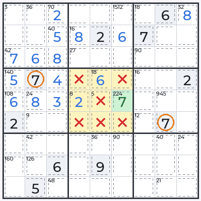

#### Step 17: the 8 in box 5

Box 5 needs an 8. r4c4 and r6c4: column 4 has one (r2c4). r5c5: row 5 has one (r5c2). r4c6: the cage of 18 (with 6 already in it) leaves 3 to make, and 8 doesn't go into it. r6c5: the cage's digits multiply to 5, and 8 doesn't go into it. Only **r6c6** is left: **r6c6 = 8**.

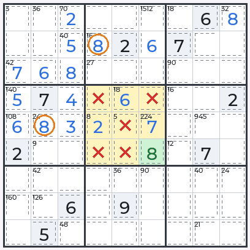

#### Step 18: the 4 in box 5

Box 5 needs a 4. r4c4 and r4c6: row 4 has one (r4c3). r5c5 and r6c5: the cage's digits multiply to 5, and 4 doesn't go into it. Only **r6c4** is left: **r6c4 = 4**.

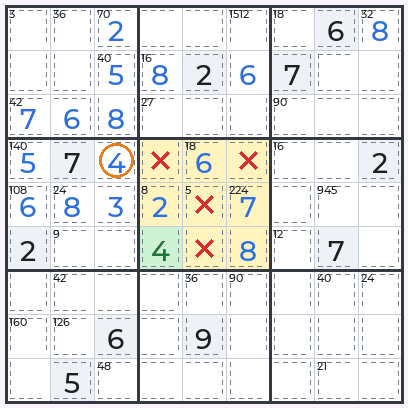

#### Step 19: the 9 in box 5

Box 5 needs a 9. r5c5 and r6c5: column 5 has one (r8c5). r4c6: the cage of 18 (with 6 already in it) leaves 3 to make, and 9 doesn't go into it. Only **r4c4** is left: **r4c4 = 9**.

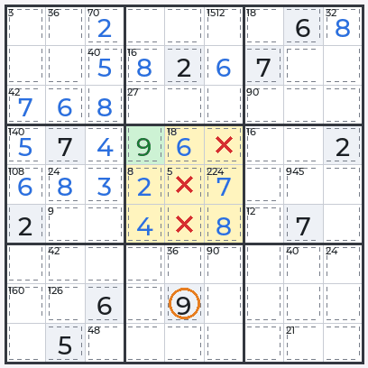

#### Step 20: the 3 in box 5

Box 5 needs a 3. r5c5: row 5 has one (r5c3). r6c5: the cage's digits multiply to 5, and 3 doesn't go into it. Only **r4c6** is left: **r4c6 = 3**.

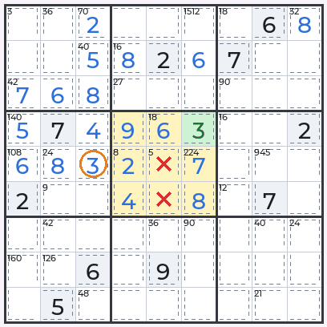

#### Step 21: the 4 in box 6

Box 6 needs a 4. r4c7 and r4c8: row 4 has one (r4c3). r6c7 and r6c9: row 6 has one (r6c4). r5c8 and r5c9: the cage of 945 (with 7 already in it) leaves 135 to make, and 4 doesn't go into it. Only **r5c7** is left: **r5c7 = 4**.

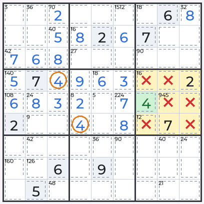

#### Step 22: the 6 in box 6

Box 6 needs a 6. r4c7 and r4c8: row 4 has one (r4c5). r5c8 and r5c9: row 5 has one (r5c1). r6c9: the cage of 945 (with 7 already in it) leaves 135 to make, and 6 doesn't go into it. Only **r6c7** is left: **r6c7 = 6**.

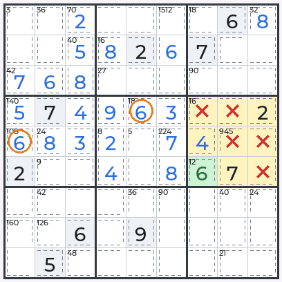

#### Step 23: the 3 in box 6

Box 6 needs a 3. r4c7 and r4c8: row 4 has one (r4c6). r5c8 and r5c9: row 5 has one (r5c3). Only **r6c9** is left: **r6c9 = 3**.

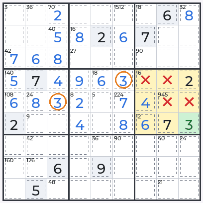

#### Step 24: the 2 in box 7

Box 7 needs a 2. r7c1, r8c1 and r9c1: column 1 has one (r6c1). r7c3 and r9c3: column 3 has one (r1c3). r8c2: the cage of 126 (with 6 already in it) leaves 21 to make, and 2 doesn't go into it. Only **r7c2** is left: **r7c2 = 2**.

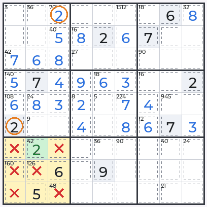

#### Step 25: the 1 in box 7

Box 7 needs a 1. r7c1: the cage of 108 (with 6 and 2 already in it) needs 9 there. r7c3: in the cage of 42 (with 2 already in it), a 1 would leave 21 for its other cell, which different digits can't make. r8c1 and r9c1: in the cage of 160 (with 5 already in it), a 1 would leave 32 for its other cell, which different digits can't make. r8c2: in the cage of 126 (with 6 already in it), a 1 would leave 21 for its other cell, which different digits can't make. Only **r9c3** is left: **r9c3 = 1**.

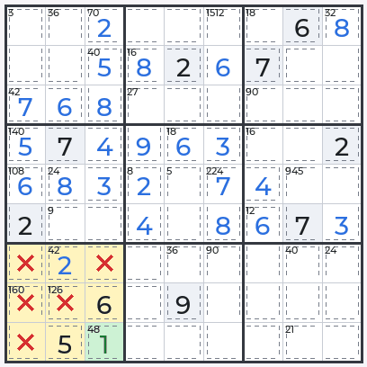

#### Step 26: the 1 in box 4

Box 4 needs a 1. r6c3: column 3 has one (r9c3). Only **r6c2** is left: **r6c2 = 1**.

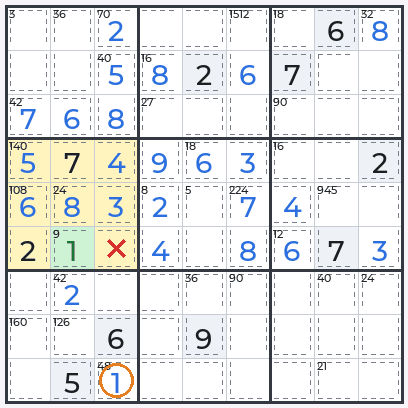

#### Step 27: the 9 in box 4

Box 4 needs a 9, and r6c3 is its last empty cell: **r6c3 = 9**.

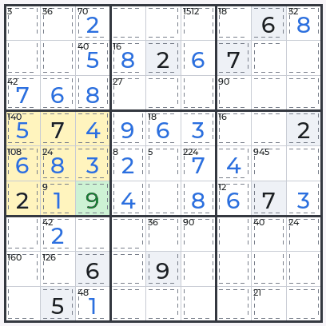

#### Step 28: the 1 in box 5

Box 5 needs a 1. r6c5: row 6 has one (r6c2). Only **r5c5** is left: **r5c5 = 1**.

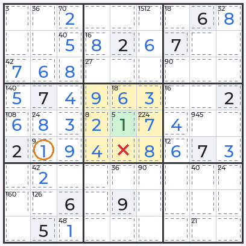

#### Step 29: the 1 in box 2

Box 2 needs a 1. r1c5 and r3c5: column 5 has one (r5c5). r1c4: in the cage of 70 (with 2 already in it), a 1 would leave 35 for its other cell, which different digits can't make. r1c6 and r3c6: in the cage of 1512 (with 6 and 7 already in it), a 1 would leave 36 for its other cell, which different digits can't make. Only **r3c4** is left: **r3c4 = 1**.

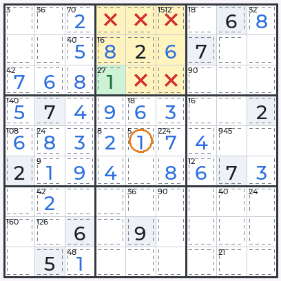

#### Step 30: the 3 in box 2

Box 2 needs a 3. r1c6 and r3c6: column 6 has one (r4c6). r1c4 and r1c5: the cage of 70 (with 2 already in it) leaves 35 to make, and 3 doesn't go into it. Only **r3c5** is left: **r3c5 = 3**.

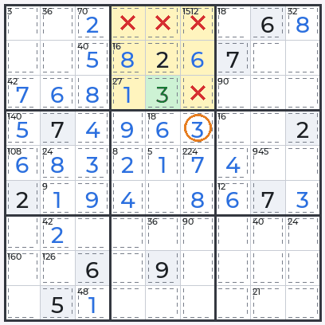

#### Step 31: the 3 in box 3

Box 3 needs a 3. r2c9: column 9 has one (r6c9). r3c7, r3c8 and r3c9: row 3 has one (r3c5). r2c8: the cage of 32 (with 8 already in it) leaves 4 to make, and 3 doesn't go into it. Only **r1c7** is left: **r1c7 = 3**.

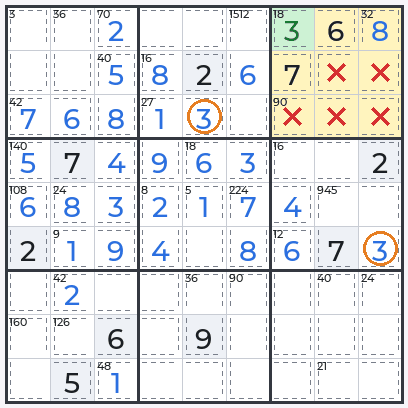

#### Step 32: the 3 in box 1

Box 1 needs a 3. r1c1 and r1c2: row 1 has one (r1c7). r2c2: in the cage of 36, a 3 would leave 12 for its other cell, which different digits can't make. Only **r2c1** is left: **r2c1 = 3**.

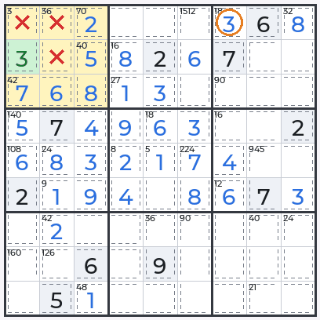

#### Step 33: the 1 in box 1

Box 1 needs a 1. r1c2 and r2c2: column 2 has one (r6c2). Only **r1c1** is left: **r1c1 = 1**.

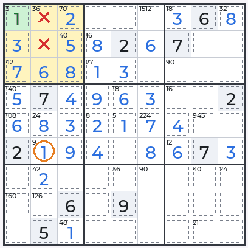

#### Step 34: the 5 in box 5

Box 5 needs a 5, and r6c5 is its last empty cell: **r6c5 = 5**.

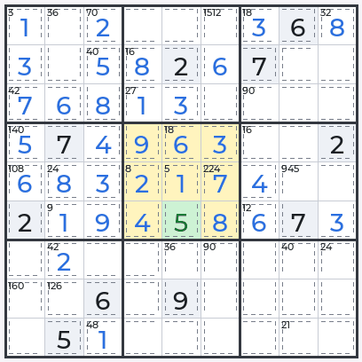

#### Step 35: the 5 in box 2

Box 2 needs a 5. r1c5: column 5 has one (r6c5). r1c6 and r3c6: the cage of 1512 (with 6 and 7 already in it) leaves 36 to make, and 5 doesn't go into it. Only **r1c4** is left: **r1c4 = 5**.

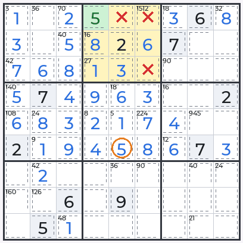

#### Step 36: the 7 in box 2

Box 2 needs a 7. r1c6: column 6 has one (r5c6). r3c6: row 3 has one (r3c1). Only **r1c5** is left: **r1c5 = 7**.

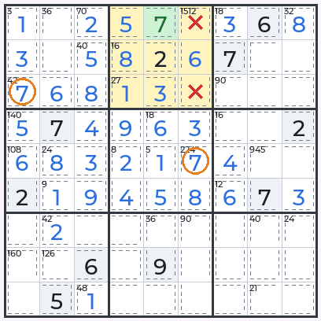

#### Step 37: the 3 in box 7

Box 7 needs a 3. r7c1, r8c1 and r9c1: column 1 has one (r2c1). r7c3: column 3 has one (r5c3). Only **r8c2** is left: **r8c2 = 3**.

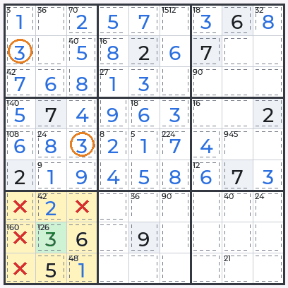

#### Step 38: the 7 in box 7

Box 7 needs a 7. r7c1, r8c1 and r9c1: column 1 has one (r3c1). Only **r7c3** is left: **r7c3 = 7**.

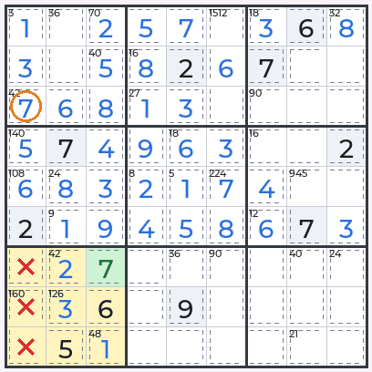

#### Step 39: the 9 in box 7

Box 7 needs a 9. r8c1: row 8 has one (r8c5). r9c1: the cage of 160 (with 5 already in it) leaves 32 to make, and 9 doesn't go into it. Only **r7c1** is left: **r7c1 = 9**.

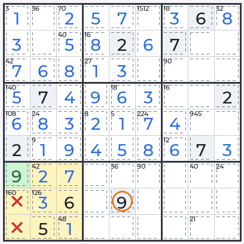

#### Step 40: the 3 in box 8

Box 8 needs a 3. r7c5 and r9c5: column 5 has one (r3c5). r7c6 and r9c6: column 6 has one (r4c6). r8c4 and r8c6: row 8 has one (r8c2). r9c4: in the cage of 48 (with 1 already in it), a 3 would leave 16 for its other cell, which different digits can't make. Only **r7c4** is left: **r7c4 = 3**.

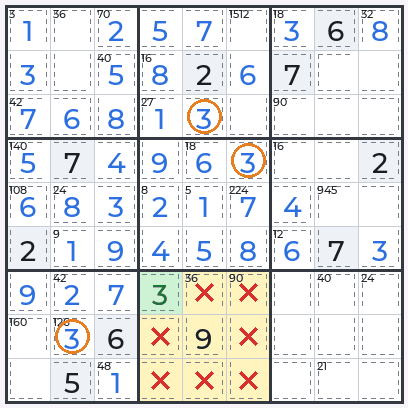

#### Step 41: the 4 in box 8

Box 8 needs a 4. r8c4 and r9c4: column 4 has one (r6c4). r7c6, r8c6 and r9c6: the cage's digits multiply to 90, and 4 doesn't go into it. r9c5: in the cage of 48 (with 1 already in it), a 4 would leave 12 for its other cell, which different digits can't make. Only **r7c5** is left: **r7c5 = 4**.

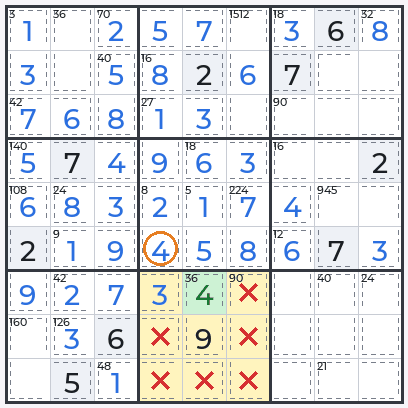

#### Step 42: the 6 in box 8

Box 8 needs a 6. r7c6 and r9c6: column 6 has one (r2c6). r8c4 and r8c6: row 8 has one (r8c3). r9c5: column 5 has one (r4c5). Only **r9c4** is left: **r9c4 = 6**.

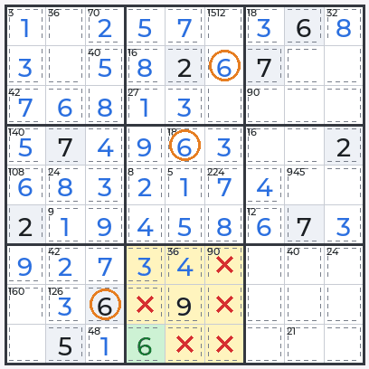

#### Step 43: the 7 in box 8

Box 8 needs a 7. r7c6: row 7 has one (r7c3). r8c6 and r9c6: column 6 has one (r5c6). r9c5: column 5 has one (r1c5). Only **r8c4** is left: **r8c4 = 7**.

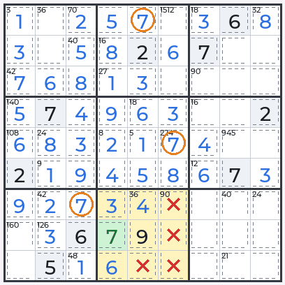

#### Step 44: the 8 in box 8

Box 8 needs an 8. r7c6, r8c6 and r9c6: column 6 has one (r6c6). Only **r9c5** is left: **r9c5 = 8**.

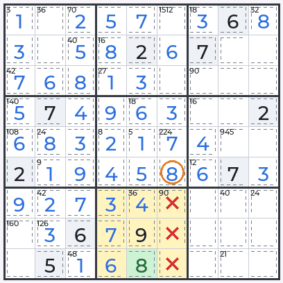

#### Step 45: the 8 in box 7

Box 7 needs an 8. r9c1: row 9 has one (r9c5). Only **r8c1** is left: **r8c1 = 8**.

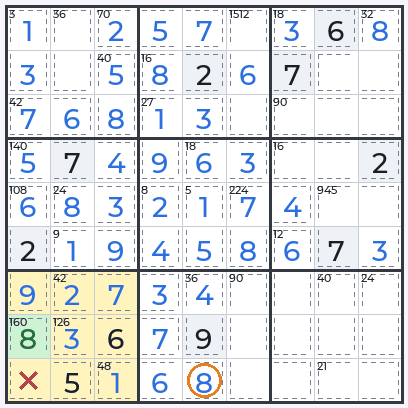

#### Step 46: the 4 in box 7

Box 7 needs a 4, and r9c1 is its last empty cell: **r9c1 = 4**.

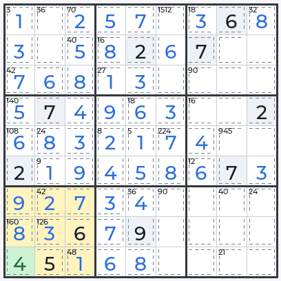

#### Step 47: the 3 in box 9

Box 9 needs a 3. r7c7, r7c8 and r7c9: row 7 has one (r7c4). r8c7, r8c8 and r8c9: row 8 has one (r8c2). r9c7: column 7 has one (r1c7). r9c9: column 9 has one (r6c9). Only **r9c8** is left: **r9c8 = 3**.

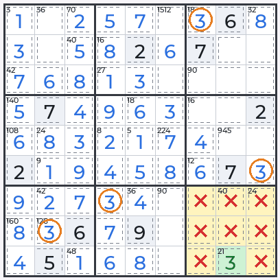

#### Step 48: the 4 in box 9

Box 9 needs a 4. r7c7, r7c8 and r7c9: row 7 has one (r7c5). r8c7: column 7 has one (r5c7). r9c7 and r9c9: row 9 has one (r9c1). r8c8: in the cage of 40, a 4 would leave 10 for its other cell, which different digits can't make. Only **r8c9** is left: **r8c9 = 4**.

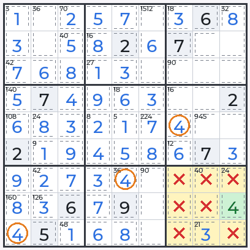

#### Step 49: the 4 in box 3

Box 3 needs a 4. r2c9 and r3c9: column 9 has one (r8c9). r3c7: column 7 has one (r5c7). r3c8: the cage's digits multiply to 90, and 4 doesn't go into it. Only **r2c8** is left: **r2c8 = 4**.

#### Step 50: the 4 in box 1

Box 1 needs a 4. r2c2: row 2 has one (r2c8). Only **r1c2** is left: **r1c2 = 4**.

#### Step 51: the 9 in box 1

Box 1 needs a 9, and r2c2 is its last empty cell: **r2c2 = 9**.

#### Step 52: the 4 in box 2

Box 2 needs a 4. r1c6: row 1 has one (r1c2). Only **r3c6** is left: **r3c6 = 4**.

#### Step 53: the 9 in box 2

Box 2 needs a 9, and r1c6 is its last empty cell: **r1c6 = 9**.

#### Step 54: the 1 in box 3

Box 3 needs a 1. r3c7, r3c8 and r3c9: row 3 has one (r3c4). Only **r2c9** is left: **r2c9 = 1**.

#### Step 55: the 6 in box 9

Box 9 needs a 6. r7c7: column 7 has one (r6c7). r7c8: column 8 has one (r1c8). r8c7 and r8c8: row 8 has one (r8c3). r9c7 and r9c9: row 9 has one (r9c4). Only **r7c9** is left: **r7c9 = 6**.

#### Step 56: the 7 in box 9

Box 9 needs a 7. r7c7 and r7c8: row 7 has one (r7c3). r8c7 and r8c8: row 8 has one (r8c4). r9c7: column 7 has one (r2c7). Only **r9c9** is left: **r9c9 = 7**.

#### Step 57: the 8 in box 9

Box 9 needs an 8. r8c7 and r8c8: row 8 has one (r8c1). r9c7: row 9 has one (r9c5). r7c7: the cage of 12 (with 6 already in it) leaves 2 to make, and 8 doesn't go into it. Only **r7c8** is left: **r7c8 = 8**.

#### Step 58: the 8 in box 6

Box 6 needs an 8. r4c8: column 8 has one (r7c8). r5c8 and r5c9: row 5 has one (r5c2). Only **r4c7** is left: **r4c7 = 8**.

#### Step 59: the 1 in box 6

Box 6 needs a 1. r5c8 and r5c9: row 5 has one (r5c5). Only **r4c8** is left: **r4c8 = 1**.

#### Step 60: the 5 in box 9

Box 9 needs a 5. r9c7: row 9 has one (r9c2). r7c7 and r8c7: the cage of 12 (with 6 already in it) leaves 2 to make, and 5 doesn't go into it. Only **r8c8** is left: **r8c8 = 5**.

#### Step 61: the 5 in box 6

Box 6 needs a 5. r5c8: column 8 has one (r8c8). Only **r5c9** is left: **r5c9 = 5**.

#### Step 62: the 5 in box 3

Box 3 needs a 5. r3c8: column 8 has one (r8c8). r3c9: column 9 has one (r5c9). Only **r3c7** is left: **r3c7 = 5**.

#### Step 63: the 2 in box 3

Box 3 needs a 2. r3c9: column 9 has one (r4c9). Only **r3c8** is left: **r3c8 = 2**.

#### Step 64: the 9 in box 3

Box 3 needs a 9, and r3c9 is its last empty cell: **r3c9 = 9**.

#### Step 65: the 9 in box 6

Box 6 needs a 9, and r5c8 is its last empty cell: **r5c8 = 9**.

#### Step 66: the 5 in box 8

Box 8 needs a 5. r8c6: row 8 has one (r8c8). r9c6: row 9 has one (r9c2). Only **r7c6** is left: **r7c6 = 5**.

#### Step 67: the 1 in box 8

Box 8 needs a 1. r9c6: row 9 has one (r9c3). Only **r8c6** is left: **r8c6 = 1**.

#### Step 68: the 2 in box 8

Box 8 needs a 2, and r9c6 is its last empty cell: **r9c6 = 2**.

#### Step 69: the 1 in box 9

Box 9 needs a 1. r8c7: row 8 has one (r8c6). r9c7: row 9 has one (r9c3). Only **r7c7** is left: **r7c7 = 1**.

#### Step 70: the 2 in box 9

Box 9 needs a 2. r9c7: row 9 has one (r9c6). Only **r8c7** is left: **r8c7 = 2**.

#### Step 71: the 9 in box 9

Box 9 needs a 9, and r9c7 is its last empty cell: **r9c7 = 9**.

Solved.

<!-- /walkthrough -->
