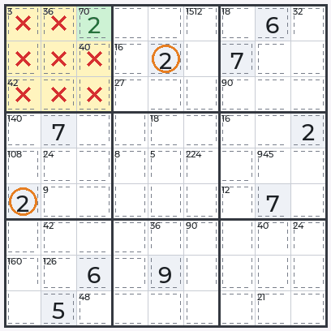

<!-- Written by tools/walkthrough.py product-killer: edit the script, not this page. -->
# Product Killer, step 1: the 2 in box 1

**Step 1 of 71** · [← The start](../product-killer.md#the-whole-puzzle-step-by-step) · [All steps](../product-killer.md#the-whole-puzzle-step-by-step) · [Step 2 →](step-02.md)

Box 1 needs a 2. r1c1 and r3c1: column 1 has one (r6c1). r2c1, r2c2 and r2c3: row 2 has one (r2c5). r1c2: in the cage of 36, a 2 would leave 18 for its other cell, which different digits can't make. r3c2: in the cage of 42, a 2 would leave 21 for its other cell, which different digits can't make. r3c3: in the cage of 40, a 2 would leave 20 for its other cell, which different digits can't make. Only **r1c3** is left: **r1c3 = 2**.

**Step 1 of 71** · [← The start](../product-killer.md#the-whole-puzzle-step-by-step) · [All steps](../product-killer.md#the-whole-puzzle-step-by-step) · [Step 2 →](step-02.md)
