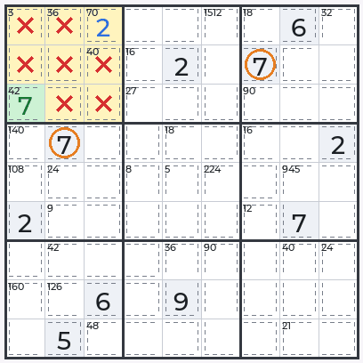

<!-- Written by tools/walkthrough.py product-killer: edit the script, not this page. -->
# Product Killer, step 2: the 7 in box 1

**Step 2 of 71** · [← Step 1](step-01.md) · [All steps](../product-killer.md#the-whole-puzzle-step-by-step) · [Step 3 →](step-03.md)

Box 1 needs a 7. r1c2 and r3c2: column 2 has one (r4c2). r2c1, r2c2 and r2c3: row 2 has one (r2c7). r1c1: the cage's digits multiply to 3, and 7 doesn't go into it. r3c3: the cage's digits multiply to 40, and 7 doesn't go into it. Only **r3c1** is left: **r3c1 = 7**.

**Step 2 of 71** · [← Step 1](step-01.md) · [All steps](../product-killer.md#the-whole-puzzle-step-by-step) · [Step 3 →](step-03.md)
