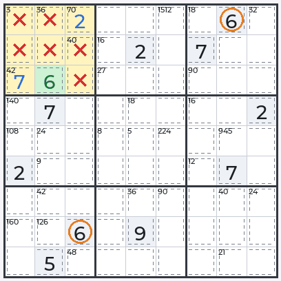

<!-- Written by tools/walkthrough.py product-killer: edit the script, not this page. -->
# Product Killer, step 3: the 6 in box 1

**Step 3 of 71** · [← Step 2](step-02.md) · [All steps](../product-killer.md#the-whole-puzzle-step-by-step) · [Step 4 →](step-04.md)

Box 1 needs a 6. r1c1 and r1c2: row 1 has one (r1c8). r2c3 and r3c3: column 3 has one (r8c3). r2c1: the cage's digits multiply to 3, and 6 doesn't go into it. r2c2: in the cage of 36, a 6 would leave 6 for its other cell, which different digits can't make. Only **r3c2** is left: **r3c2 = 6**.

**Step 3 of 71** · [← Step 2](step-02.md) · [All steps](../product-killer.md#the-whole-puzzle-step-by-step) · [Step 4 →](step-04.md)
