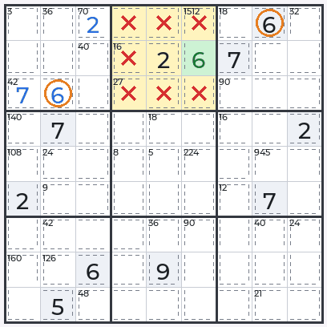

<!-- Written by tools/walkthrough.py product-killer: edit the script, not this page. -->
# Product Killer, step 4: the 6 in box 2

**Step 4 of 71** · [← Step 3](step-03.md) · [All steps](../product-killer.md#the-whole-puzzle-step-by-step) · [Step 5 →](step-05.md)

Box 2 needs a 6. r1c4, r1c5 and r1c6: row 1 has one (r1c8). r3c4, r3c5 and r3c6: row 3 has one (r3c2). r2c4: the cage of 16 (with 2 already in it) leaves 8 to make, and 6 doesn't go into it. Only **r2c6** is left: **r2c6 = 6**.

**Step 4 of 71** · [← Step 3](step-03.md) · [All steps](../product-killer.md#the-whole-puzzle-step-by-step) · [Step 5 →](step-05.md)
