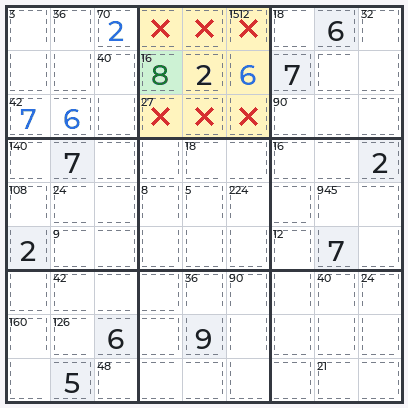

<!-- Written by tools/walkthrough.py product-killer: edit the script, not this page. -->
# Product Killer, step 5: the 8 in box 2

**Step 5 of 71** · [← Step 4](step-04.md) · [All steps](../product-killer.md#the-whole-puzzle-step-by-step) · [Step 6 →](step-06.md)

Box 2 needs an 8. r1c4 and r1c5: the cage of 70 (with 2 already in it) leaves 35 to make, and 8 doesn't go into it. r1c6 and r3c6: the cage of 1512 (with 6 and 7 already in it) leaves 36 to make, and 8 doesn't go into it. r3c4 and r3c5: the cage's digits multiply to 27, and 8 doesn't go into it. Only **r2c4** is left: **r2c4 = 8**.

**Step 5 of 71** · [← Step 4](step-04.md) · [All steps](../product-killer.md#the-whole-puzzle-step-by-step) · [Step 6 →](step-06.md)
