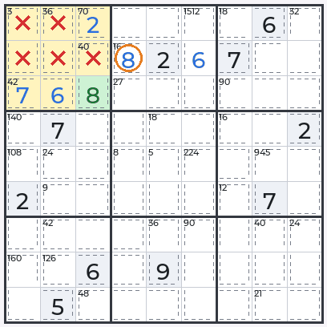

<!-- Written by tools/walkthrough.py product-killer: edit the script, not this page. -->
# Product Killer, step 6: the 8 in box 1

**Step 6 of 71** · [← Step 5](step-05.md) · [All steps](../product-killer.md#the-whole-puzzle-step-by-step) · [Step 7 →](step-07.md)

Box 1 needs an 8. r2c1, r2c2 and r2c3: row 2 has one (r2c4). r1c1: the cage's digits multiply to 3, and 8 doesn't go into it. r1c2: the cage's digits multiply to 36, and 8 doesn't go into it. Only **r3c3** is left: **r3c3 = 8**.

**Step 6 of 71** · [← Step 5](step-05.md) · [All steps](../product-killer.md#the-whole-puzzle-step-by-step) · [Step 7 →](step-07.md)
