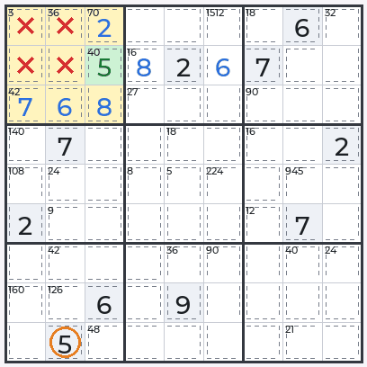

<!-- Written by tools/walkthrough.py product-killer: edit the script, not this page. -->
# Product Killer, step 7: the 5 in box 1

**Step 7 of 71** · [← Step 6](step-06.md) · [All steps](../product-killer.md#the-whole-puzzle-step-by-step) · [Step 8 →](step-08.md)

Box 1 needs a 5. r1c2 and r2c2: column 2 has one (r9c2). r1c1 and r2c1: the cage's digits multiply to 3, and 5 doesn't go into it. Only **r2c3** is left: **r2c3 = 5**.

**Step 7 of 71** · [← Step 6](step-06.md) · [All steps](../product-killer.md#the-whole-puzzle-step-by-step) · [Step 8 →](step-08.md)
