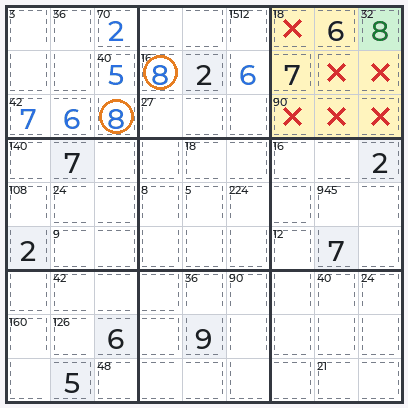

<!-- Written by tools/walkthrough.py product-killer: edit the script, not this page. -->
# Product Killer, step 8: the 8 in box 3

**Step 8 of 71** · [← Step 7](step-07.md) · [All steps](../product-killer.md#the-whole-puzzle-step-by-step) · [Step 9 →](step-09.md)

Box 3 needs an 8. r2c8 and r2c9: row 2 has one (r2c4). r3c7, r3c8 and r3c9: row 3 has one (r3c3). r1c7: the cage of 18 (with 6 already in it) leaves 3 to make, and 8 doesn't go into it. Only **r1c9** is left: **r1c9 = 8**.

**Step 8 of 71** · [← Step 7](step-07.md) · [All steps](../product-killer.md#the-whole-puzzle-step-by-step) · [Step 9 →](step-09.md)
