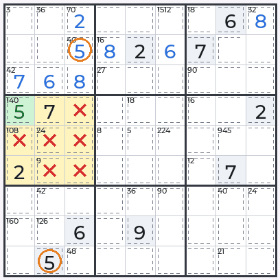

<!-- Written by tools/walkthrough.py product-killer: edit the script, not this page. -->
# Product Killer, step 9: the 5 in box 4

**Step 9 of 71** · [← Step 8](step-08.md) · [All steps](../product-killer.md#the-whole-puzzle-step-by-step) · [Step 10 →](step-10.md)

Box 4 needs a 5. r4c3, r5c3 and r6c3: column 3 has one (r2c3). r5c2 and r6c2: column 2 has one (r9c2). r5c1: the cage of 108 (with 2 already in it) leaves 54 to make, and 5 doesn't go into it. Only **r4c1** is left: **r4c1 = 5**.

**Step 9 of 71** · [← Step 8](step-08.md) · [All steps](../product-killer.md#the-whole-puzzle-step-by-step) · [Step 10 →](step-10.md)
