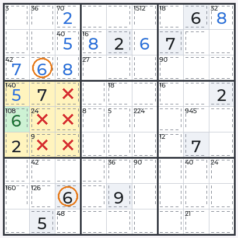

<!-- Written by tools/walkthrough.py product-killer: edit the script, not this page. -->
# Product Killer, step 10: the 6 in box 4

**Step 10 of 71** · [← Step 9](step-09.md) · [All steps](../product-killer.md#the-whole-puzzle-step-by-step) · [Step 11 →](step-11.md)

Box 4 needs a 6. r4c3, r5c3 and r6c3: column 3 has one (r8c3). r5c2 and r6c2: column 2 has one (r3c2). Only **r5c1** is left: **r5c1 = 6**.

**Step 10 of 71** · [← Step 9](step-09.md) · [All steps](../product-killer.md#the-whole-puzzle-step-by-step) · [Step 11 →](step-11.md)
